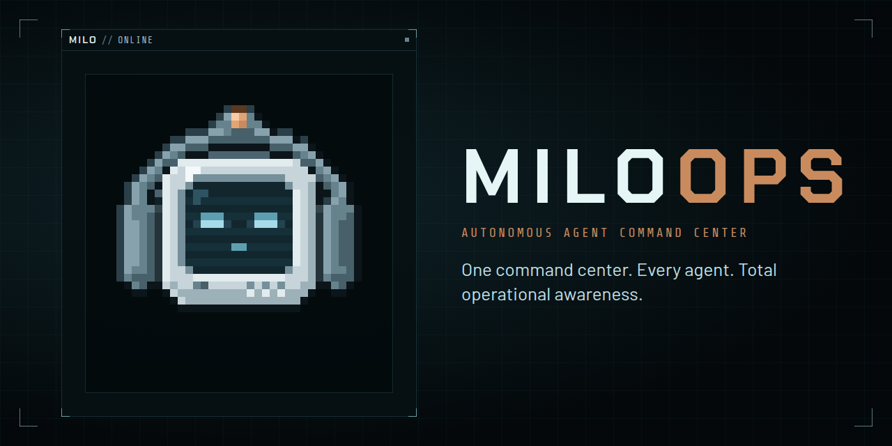

# MILOOPS

> One command center. Every agent. Total operational awareness.

**MILOOPS is a local command center for big work done by your AI coding agents.** You describe a mission; your agents learn your project, map the work as decisions, and bring you only the calls that need you. MILO, the operator, briefs you on what changed while you were away.

- **It learns your project first:** a short brief of what exists and what it assumes, before anything is built.
- **Only what needs you, in the right order:** one ranked list of questions, approvals and stuck work. Only urgent things interrupt.
- **You decide what's always yours:** database changes, logins, billing, deleting data. Agents ask instead of deciding.
- **Done means proven:** you agree on what done means up front, and every point needs proof from your tests, a second agent or you.
- **Plans that change when the facts do:** when an assumption breaks, an agent proposes a new plan. Nothing changes until you approve.
- **Your data stays yours:** missions are plain files in your repo. There is no MILOOPS server.

Works with any coding agent that connects over MCP. Claude Code and Codex are the primary supported agents.

## Status

**Not released yet.** This package is a placeholder until launch; running it only prints a short message.

Follow along at **[miloops.vercel.app](https://miloops.vercel.app)**, or watch the repository: **[github.com/miloopshq/miloops](https://github.com/miloopshq/miloops)**.

## License

[FSL-1.1-ALv2](LICENSE): free to use, modify and run, including at work, for anything except a competing product. Each release becomes Apache 2.0 two years after it ships.
