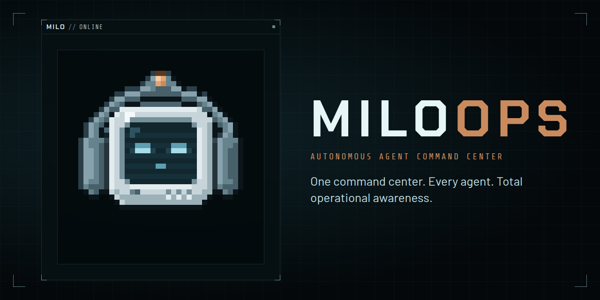

# MILOOPS

> One command center. Every agent. Total operational awareness.

**Mission:** MILOOPS is the place where a human can define an objective, assemble the right AI capabilities, delegate work, follow meaningful progress, intervene when necessary and trust the outcome.

**The name:** MILO is the Mission Intelligence & Logistics Operator. MILOOPS is MILO Operations, the command center where MILO runs your agents' missions.

MILOOPS is a local command center for planning and executing big work with your AI coding agents. You describe a mission; your agents chart it as decision tickets, work through them, and bring the calls that need you to a single inbox. MILO, the command center's operator, briefs you on what changed while you were away and keeps spend and token usage in view.

- **Missions and decision tickets:** a live map of what's decided, in progress, blocked and out of scope.
- **Waiting on you:** every question from every agent, in one inbox, answered in-window.
- **Decision records:** each call is written down with its alternatives, rationale and transcript.
- **Live spend:** per-session and per-mission tokens and cost.
- **Your data stays yours:** missions are plain markdown in `./.miloops/` in your repo. Nothing leaves your machine.

Works with any coding agent that connects over MCP. Claude Code and Codex are the primary supported agents.

## Install

Requires Node 20+.

```bash
npm i -g miloops      # or, without installing: npx miloops
cd your-repo
miloops
```

`miloops` opens the command center in your browser. Run `miloops --help` for options.

Connect your agent once, then use `/milo new "<idea>"`, `/milo resume`, `/milo status` and `/milo inbox`:

```bash
claude mcp add miloops -- npx -y miloops mcp   # Claude Code; `npx miloops connect claude` also adds /milo
codex mcp add miloops -- npx -y miloops mcp    # Codex; see packages/cli for the config.toml entry
```

Details for both agents are in [`packages/cli/README.md`](packages/cli/README.md#connect-your-coding-agent).

## Repository

| Path | Package | |
| --- | --- | --- |
| [`packages/core`](packages/core) | `@miloops-hq/core` | UI-free engine: missions, tickets, trackers, metrics, decision records |
| [`packages/cli`](packages/cli) | [`miloops`](https://www.npmjs.com/package/miloops) | The `miloops` command: serves the command center and the tracker API |
| [`packages/milo-avatar`](packages/milo-avatar) | `@miloops-hq/milo-avatar` | Pixel-art MILO avatar (React component and framework-free renderer) |
| [`apps/command-center`](apps/command-center) | private | The command-center web UI bundled into the CLI |
| [`apps/landing`](apps/landing) | private | The [miloops.app](https://miloops.app) site |
| [`brand`](brand) | | Logos, avatars and social images |

## Develop

```bash
npm install
npm run dev           # command center with hot reload, http://localhost:5173
npm run dev:landing   # landing page
npm run typecheck     # every workspace
npm test              # unit and MCP tests (vitest)
npm run verify:mcp    # after a build: an MCP client drives a mission while the command center shows it
npm run build         # every workspace; the CLI lands in packages/cli/dist
npm start             # run the built CLI (same as `miloops`)
npm run lint          # ESLint across the monorepo
npm run check         # lint, typecheck, build, test and verify:mcp; run before opening a PR
```

See [`apps/command-center/README.md`](apps/command-center/README.md) for the architecture, metrics and tracker API, and [`CONTRIBUTING.md`](CONTRIBUTING.md) for code standards.

## License

[MIT](LICENSE). Third-party credits are in [`THIRD_PARTY_NOTICES.md`](THIRD_PARTY_NOTICES.md).
